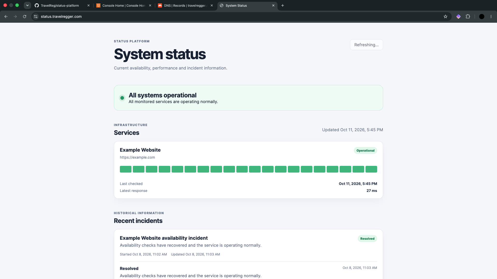
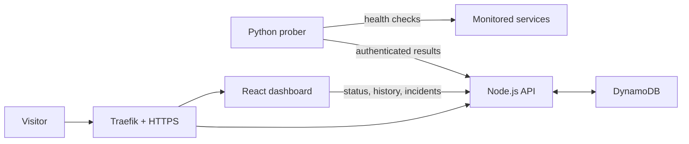

# Status Platform

Status Platform is a small, self-hosted uptime monitor and public status page. A Python worker checks the configured services, the Node.js API stores and evaluates those checks, and a React dashboard turns the results into a simple view of current availability, response times, and incidents.

The live dashboard is available at [status.travelregger.com](https://status.travelregger.com).

<p align="center">
  <a href="https://status.travelregger.com">
    
  </a>
</p>

<p align="center"><sub>The live dashboard brings service health, response history, and incident updates into one view.</sub></p>

This project is intentionally deployment-focused. The application runs on a single K3s node in AWS; the development machine is only used for source control, Terraform, the AWS CLI, and administration.

## How it works



The prober runs every 60 seconds and sends each result to the API. The API keeps probe history in DynamoDB and derives a stable service state from consecutive checks. The dashboard refreshes every 30 seconds and combines those service states with manually managed incidents.

Everything runs as containers on a single-node K3s cluster. Traefik handles ingress, cert-manager manages the Let's Encrypt certificate, and GitHub Actions builds and deploys immutable images from Amazon ECR. Deployments reach the server through AWS Systems Manager, so neither SSH nor the Kubernetes API is exposed publicly.

## Monitoring rules

- A check times out after 5 seconds.
- HTTP 200–399 is a success; HTTP errors, connection errors, and timeouts are failures.
- Two consecutive failures mark a service as down.
- Two consecutive successes bring it back to operational.
- A service is shown as unknown until it has a result, or when its latest result is more than three minutes old.

Incidents are managed separately from automatic checks. This allows an operator to explain an outage, post updates, and resolve the incident without changing the underlying probe history. The exact rules are documented in [docs/behavior.md](docs/behavior.md).

## Project layout

| Path | What lives there |
|---|---|
| `api/` | Express API, DynamoDB stores, status rules, and incident management |
| `frontend/` | React/Vite dashboard served by Nginx |
| `prober/` | Dependency-free Python monitoring worker |
| `k8s/` | K3s workloads, ingress, TLS, and deployment scripts |
| `terraform/` | AWS networking, EC2, DynamoDB, ECR, IAM, and GitHub OIDC |
| `.github/workflows/` | Test, image-build, and deployment pipelines |
| `docs/` | Behavior notes and the production operations runbook |

The monitored services are currently defined in two places: `api/src/services.js` controls what the public API displays, while `PROBE_TARGETS_JSON` in `k8s/prober.yaml` controls what the worker checks. Keep their service IDs in sync when adding or removing a target.

## Working on the project

You will need Node.js 24 and Python 3.13 to run the same checks as CI. The API and frontend keep their dependencies separate:

```bash
npm --prefix api ci
npm --prefix frontend ci
```

Run the test suites and build the dashboard with:

```bash
node --test api/test/*.test.js
npm --prefix frontend test
npm --prefix frontend run build
PYTHONPATH=prober/src python3 -m unittest discover \
  --start-directory prober/test \
  --verbose
```

The API can be started locally with `npm --prefix api start`. Without DynamoDB table names it still exposes `/api/health` and returns the configured services with an `unknown` state; history and incident storage require AWS credentials and the relevant table environment variables.

## API overview

| Method | Route | Access | Purpose |
|---|---|---|---|
| `GET` | `/api/health` | Public | API health check |
| `GET` | `/api/services` | Public | Current state of every service |
| `GET` | `/api/services/:serviceId/history` | Public | Recent probe results |
| `GET` | `/api/incidents` | Public | Current and past incidents |
| `POST` | `/api/probes` | Probe token | Store a check result |
| `POST` | `/api/admin/incidents` | Admin token | Create an incident |
| `PATCH` | `/api/admin/incidents/:incidentId` | Admin token | Update or resolve an incident |

Probe and admin tokens are deliberately separate. Public routes are read-only.

## Infrastructure and deployment

Terraform provisions the AWS foundation: a VPC, EC2 instance with a stable Elastic IP, DynamoDB tables, private ECR repositories, IAM roles, and GitHub's OpenID Connect trust. K3s, Traefik, and the SSM agent are prepared on the instance during boot.

Changes to the API, frontend, or prober are tested and built by their own GitHub Actions workflows. A successful image build automatically starts the matching deployment workflow, which verifies the image, sends the deployment through Systems Manager, and waits for the Kubernetes rollout to finish. Ingress and certificate changes use the separate platform deployment workflow.

For provisioning, manual deployments, log inspection, certificate checks, recovery, and teardown, use the [operations runbook](docs/operations.md). It also records the required secrets and the checks to perform after a deployment.

## Current limits

This is a compact deployment, not a highly available one. The K3s control plane and all workloads share one EC2 instance in one Availability Zone, and checks currently run from one region. DynamoDB keeps probe and incident data outside the node, so replacing the server does not remove history, but an instance or Availability Zone failure can still interrupt the dashboard until recovery completes.
